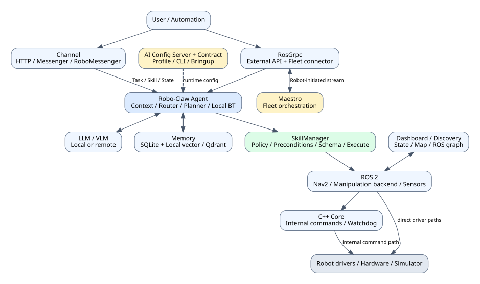
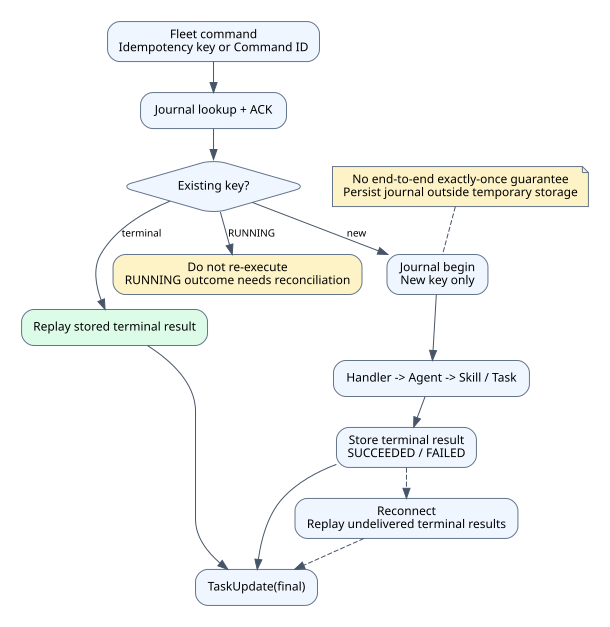
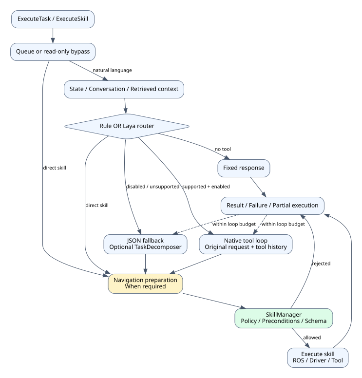

# 로보클로 로봇 에이전트 기술 문서

이 문서는 Robo-Claw의 시스템 구조, 작업 실행, 인지·메모리, 안전 정책, 외부 인터페이스와 운영·검증 절차를 설명합니다. 기술 제출과 검토를 위한 통합 문서로, 소스 구현과 검증의 범위를 구분합니다.

| 항목 | 내용 |
| --- | --- |
| 문서 버전 | 1.0 |
| 문서 상태 | 제출 검토용 |
| 작성일 | 2026-11-12 |
| 대상 소프트웨어 | Robo-Claw / RoboClaw |
| 선언 소프트웨어 버전 | `0.1.0` (`pyproject.toml` 기준) |
| 기준 커밋 | `0b555f180621a0e8e346a0f124a87bc08bd367e8` |
| 기준 커밋 일자 | 2026-11-10 |
| 기준 커밋 제목 | `fix(manipulation): 작업자 지지 팔 자세를 stow 참조값으로 기록` |
| 공통 설정 계약 버전 | `2.13.0` (`contracts/contract.lock.json` 기준) |
| 구성 참고 | Robo-Claw Maestro의 `docs/TECHNICAL_DOCUMENT.md` |

> 선언 버전은 정식 릴리스, 안전 인증 또는 실기기 인수 완료를 의미하지 않습니다. 본문은 기준 커밋의 소스와 저장소 가이드를 근거로 설명하며, 물리 동작과 성능은 로봇 모델·드라이버·배포 환경별로 검증해야 합니다. 별도 표시가 없는 파일 경로는 Robo-Claw 저장소 루트를 기준으로 합니다.

## 차례

1. 개요
2. 시스템 아키텍처
3. 핵심 모델과 실행 계약
4. 로봇 연결과 통신
5. 작업 계획과 실행
6. 안전성과 제어 정책
7. 인지·메모리·학습
8. API와 사용자 인터페이스
9. 설치와 환경 설정
10. 운영과 장애 대응
11. 테스트와 검증
12. 구현 현황과 제약사항

부록: 주요 설정, 인터페이스 계약, 실행 예제, 상태·시퀀스, 용어·참고 문서

## 1. 개요

### 1.1 목적과 주요 기능

Robo-Claw는 자연어 요청을 로봇 기능으로 연결하는 ROS 2 네이티브 AI 에이전트 런타임입니다. 사용자 명령과 로봇 상태를 함께 해석하고, 등록된 스킬을 선택·검증·실행하여 결과를 반환합니다.

주요 기능은 다음과 같이 구성합니다.

| 영역 | 제공 기능 |
| --- | --- |
| 작업 처리 | 자연어 태스크, 직접 스킬 호출, 제한된 재계획, 순차 요청 큐 |
| 로봇 제어 | Nav2 이동, 상대 이동·회전, 로봇별 팔·그리퍼 조작 |
| 인지 | 카메라·라이다·배터리·위치 조회, ONNX 객체 탐지, VLM 장면 분석 |
| 자율 행동 | 기억된 장소 순찰, 목표 기반 행동, 별도 프론티어 탐험, 반응형 감시 |
| 기억 | 장소·별칭·좌표 정확 조회, 장면·교훈 의미 검색, 실행 경험 저장 |
| 협업 | ROS 및 원격 peer 탐색·위임, 장소 양보, Maestro 관제 연동 |
| 대외 연결 | HTTP, RosGrpc, RoboMessenger, Discord·Slack·Telegram, MCP |
| 운영 | 설정 계약 동기화, CLI 진단, 대시보드, 시나리오 QA |

### 1.2 적용 시나리오

대표 시나리오는 실내 순찰·관찰, 기억된 장소 이동, 물체 탐색, 모바일 매니퓰레이터의 집기·배치, 동료 로봇에 대한 작업 요청입니다. 폐쇄망에서는 로컬 LLM과 내부 gRPC 채널을 사용하여 외부 메신저 없이 운영할 수 있습니다.

실행 가능한 범위는 등록 스킬, 로봇별 설정, 센서·지도·드라이버의 가용성에 따라 달라집니다. 자연어 계획이나 스킬 이름의 존재만으로 해당 물리 작업의 수행 가능성을 보장하지 않습니다.

### 1.3 Maestro 및 AI Config Server와의 관계

| 시스템 | 책임 |
| --- | --- |
| Robo-Claw | 개별 로봇의 문맥 해석, 스킬 실행, 현장 상태·결과 보고를 담당합니다. |
| Maestro | 여러 로봇의 Mission·Task 배정과 진행 조율, 승인·Fleet 관제를 담당합니다. |
| AI Config Server | 로봇·환경별 활성 실행 프로필과 런타임 파일의 배포 입력을 관리합니다. |
| `rcf-config-contract` | 공통 설정 필드·기본값·매핑의 기준 계약을 관리합니다. |

Robo-Claw는 Maestro 없이도 독립 실행합니다. Maestro의 Mission Behavior Tree는 중앙 서버가 실행하며, Robo-Claw에는 개별 Task·Skill 명령을 전달합니다. Robo-Claw 내부 자율 행동 BT는 이 중앙 트리와 별도의 실행 계층으로 구성합니다.

### 1.4 문서 범위와 독자

로봇 연동 개발자, 시스템 운영자, QA 담당자와 기술 검토자를 대상으로 합니다. 에이전트 소프트웨어와 외부 시스템의 경계를 설명하며, 제조사 하드웨어 매뉴얼, 드라이버 내부 구현, 안전 인증 절차와 현장별 성능 시험을 대체하지 않습니다.

## 2. 시스템 아키텍처

### 2.1 전체 시스템 구성



*그림 1. 사용자 채널, 로봇 에이전트, 기억·모델, ROS 실행 경계와 중앙 시스템의 관계를 나타냅니다. 화살표는 역할 중심의 연결을 표시하며 전체 함수 호출 순서를 의미하지 않습니다.*

시스템은 외부 요청 수집, 추론·실행 조율, 스킬 실행, ROS 통합과 하드웨어 드라이버를 분리합니다. LLM은 실행 기능을 제안하며, 스킬 실행기는 입력과 정책을 확인합니다. LLM이 직접 임의의 로봇 명령을 발행하는 구조로 취급하지 않습니다.

### 2.2 패키지별 책임

| 패키지 | 주 언어 | 주요 책임 |
| --- | --- | --- |
| `robo_claw_msgs` | ROS IDL / Protobuf | msg·srv·action 및 세 종류의 gRPC 계약을 정의합니다. |
| `robo_claw_core` | C++ | 기본 50Hz 루프, 관절 상태, 내부 베이스 명령과 watchdog을 관리합니다. |
| `robo_claw_agent` | Python | 상태·문맥, 라우팅, LLM 계획, 스킬 정책, 메모리와 자율 행동을 관리합니다. |
| `robo_claw_channel` | Python | HTTP·메신저·RoboMessenger 요청과 ROS 인터페이스를 연결합니다. |
| `robo_claw_discovery` | Python | ROS 그래프의 토픽·서비스·액션·peer 탐색을 수행합니다. |
| `robo_claw_grpc` | Python | 외부 RosGrpc 서비스와 FleetControl connector를 제공합니다. |
| `robo_claw_vision` | C++ | ONNX Runtime 객체 탐지와 `Detection2DArray` 발행을 수행합니다. |
| `robo_claw_dashboard` | Python / HTML·JS | 로컬 상태·지도·설정·로그 조회와 시나리오 UI를 제공합니다. |
| `robo_claw_bringup` | Python / YAML | 로봇별 설정과 launch 인자로 실행 구성을 조립합니다. |
| `robo_claw_cli` | Go | `rclaw` 설정 동기화, 실행, 진단과 QA를 구현합니다. |

현재 proto 원본은 `src/robo_claw_msgs/proto/`에 모아 관리합니다. 일부 기존 가이드의 channel·grpc별 proto 디렉터리 표기보다 실제 소스 위치를 우선합니다.

### 2.3 주요 구현 위치

다음 에이전트 경로는 `src/robo_claw_agent/robo_claw_agent/`를 기준으로 합니다.

| 경로 | 책임 |
| --- | --- |
| `agent_node/node.py`, `params.py`, `initialization.py` | ROS 노드, 파라미터, 초기화를 구성합니다. |
| `agent_node/execution.py`, `task_queue.py` | 요청 실행과 큐를 관리합니다. |
| `agent_node/planner/`, `task_planner.py` | 도구 호출·JSON 계획과 복합 요청 처리를 구현합니다. |
| `agent_node/fast_router.py`, `system1_router.py` | 규칙·Laya 사전 라우팅을 구현합니다. |
| `agent_node/nav_safety.py`, `sensor_health.py` | 이동 안전 게이트와 센서 상태를 처리합니다. |
| `llm_bridge/` | Provider별 LLM 어댑터를 제공합니다. |
| `skills/base.py`, `skills/manager.py` | 스킬 계약, 등록·검증·실행을 구현합니다. |
| `skills/autonomous_skill/` | 자율·반응형 BT를 구현합니다. |
| `memory_manager/`, `vector_store/` | 구조화 기억과 의미 검색을 제공합니다. |
| `manipulation_runtime/` | 로봇별 조작 백엔드를 구성합니다. |
| `mcp_adapter.py` | 외부 MCP 도구의 로딩·호출 경계를 제공합니다. |

`skill_manager.py`는 호환 import 경계로 사용하며 실제 실행기는 `skills/manager.py`에 구현합니다. 모든 Python 패키지가 Domain·Application·Adapter 구조로 완전히 분리된 상태라고 설명하지 않습니다.

### 2.4 제어 경계와 배포 구성

모든 로봇 명령이 C++ core를 통과하지는 않습니다. 주행 스킬은 Nav2 action을 사용하고, Stretch·AGX 조작은 드라이버 action·service·topic을 직접 사용합니다. 따라서 core의 watchdog이나 속도 제한을 전체 제어 경로에 대한 하드웨어 안전 인터록으로 해석하지 않습니다.

실기 구성은 로봇 드라이버·TF·센서와 Robo-Claw를 연결합니다. 시뮬레이션 구성은 Gazebo·Nav2·AMCL 또는 SLAM을 함께 사용합니다. 로컬·컨테이너·원격 프로필 실행은 launch 조립과 설정 우선순위가 다르므로 실행 방식을 고정하여 운영합니다.

## 3. 핵심 모델과 실행 계약

### 3.1 Task와 Skill

**Task**는 자연어 지시와 선택적 문맥을 가진 사용자 요청으로 구성합니다. 에이전트가 하나 이상의 스킬을 선택할 수 있습니다. **Skill**은 이름, 입력 schema, 사전조건과 결과를 가진 실행 기능으로 구성합니다.

직접 `ExecuteSkill` 요청은 LLM 추론을 우회하여 지정 스킬을 실행합니다. `ExecuteTask`는 문맥 수집과 계획 경로를 사용합니다. 두 요청을 같은 호출 의미로 취급하지 않습니다.

### 3.2 상태와 결과 모델

`AgentStatus`는 다음 상태 코드를 정의합니다.

| 상태 | 코드 | 의미 |
| --- | --- | --- |
| `IDLE` | 0 | 요청 대기 상태를 표시합니다. |
| `THINKING` | 1 | 추론·계획 상태를 표시합니다. |
| `EXECUTING` | 2 | 스킬 실행 상태를 표시합니다. |
| `WAITING` | 3 | 대기 상태를 표시합니다. |
| `ERROR` | 4 | 오류 상태를 표시합니다. |

현재 스킬, 상태 메시지, `agent_id`와 ROS header를 함께 제공합니다. 에이전트 상태는 작업 생명주기와 관련되며 전체 하드웨어의 정상 동작을 보장하지 않습니다.

ROS `SkillResult`는 `SUCCESS=0`, `FAILURE=1`, `CANCELLED=2`, `TIMEOUT=3`을 정의하고 스킬명, 메시지, 실행 시간과 `result_json`을 반환합니다. Task 결과는 전체 `success`, `result_message`와 스킬별 결과 배열을 반환합니다. 전송 성공·명령 수락·태스크 성공·물리 완료를 구분하여 판정합니다.

### 3.3 스킬 등록과 노출

`SkillManager`는 모듈의 `BaseSkill` 구현을 로드하며 활성 여부와 조작 백엔드 조건에 따라 등록합니다. 로봇·배포마다 활성 스킬이 달라지므로 스킬 수를 고정 제품 사양으로 제시하지 않습니다.

Public·Internal 노출과 위험 수준은 스킬 카탈로그에서 구분합니다. Internal 스킬은 복합 실행의 내부 단계로 사용할 수 있지만 외부 사용자와 Fleet capability에 동일하게 노출하지 않습니다. 실제 가용 목록은 실행 중 `QueryState`와 등록 로그로 확인합니다.

### 3.4 저장 데이터

| 데이터 | 저장 방식 | 운영상 의미 |
| --- | --- | --- |
| 장소·별칭·좌표, 실행 경험 | SQLite 구조화 저장소 | 임베딩 없이 정확 저장·조회합니다. |
| 비정형 지식·장면·교훈 | 로컬 벡터 저장소 또는 Qdrant | 임베딩 기반 의미 검색에 사용합니다. |
| Fleet 명령·결과 | SQLite command journal | 중복 식별과 terminal 결과 replay에 사용합니다. |
| 대화·검색·실험 기록 | 파일 로그 및 실행별 아티팩트 | 분석·QA 근거로 사용합니다. |
| 실행 설정 캐시 | CLI 캐시·런타임 파일 | 활성 프로필과 적용값을 추적합니다. |

모든 데이터를 하나의 DB 트랜잭션이나 완전한 Event Sourcing으로 관리한다고 설명하지 않습니다.

## 4. 로봇 연결과 통신

### 4.1 ROS 2 내부 통신과 발견

에이전트·채널·core·센서는 ROS topic·service·action으로 연결합니다. Discovery는 실행 중 노드의 ROS 그래프 API를 사용하며 별도의 `ros2 action list` 프로세스나 CLI daemon에 의존하여 액션을 탐색하지 않습니다.

로봇 간 연결에는 ROS 배포판, `ROS_DOMAIN_ID`, RMW 구현, TF·namespace·토픽 이름을 함께 확인합니다. 같은 DDS 도메인에 여러 로봇이 존재한다는 사실만으로 명령 대상이 올바르게 분리되는 것은 아닙니다.

### 4.2 세 종류의 gRPC 연결

| 인터페이스 | 기본 포트 | 연결 방향 | 목적 |
| --- | --- | --- | --- |
| RosGrpc | 50051 | 외부 클라이언트 → Robo-Claw | 상태·지도·카메라·제어·Skill·Task를 제공합니다. |
| RoboMessenger | 50052 | 사용자·peer → 채널 | 명령·대화·파일과 동료 통신을 제공합니다. |
| FleetControl | Maestro 측 50053 | Robo-Claw → Maestro | 등록·Telemetry·명령·결과를 양방향 stream으로 교환합니다. |

50051과 50052는 서로 다른 서비스를 사용합니다. 자연어 시나리오의 채널 명령은 RoboMessenger를 사용하며, RosGrpc에도 별도 `ExecuteTask` RPC를 정의합니다. 한 서비스의 메서드를 다른 포트로 호출하지 않습니다.

### 4.3 FleetControl 등록과 Capability

`MAESTRO_ENABLED=true`이고 RosGrpc 노드가 활성화되면 connector를 생성합니다. 이 모드에서는 `MAESTRO_IP`와 고유 `ROBOT_ID`를 필수로 사용하며, 프로세스 재시작마다 새 `session_id`를 생성합니다.

등록 직전에 에이전트 `QueryState`의 실제 등록 스킬을 조회하여 capability를 구성합니다. Internal 스킬은 제외하며 위험도·입력 schema를 함께 보고합니다. 에이전트 기동 중에는 최대 60초 동안 2초 간격으로 조회하고, 실패하면 `RC_SKILLS_GUIDE_FILE`의 스킬 카탈로그 표를 대체 입력으로 사용합니다. 사용 가이드에 스킬 이름이 적혀 있다는 사실만으로 실제 실행 구현을 추가하지 않습니다.

### 4.4 Telemetry와 명령 결과

등록 정보에는 로봇·소프트웨어·프로토콜 식별, site·map·frame과 capability를 포함합니다. Heartbeat와 Telemetry에는 배터리, 위치, 현재 Task·Skill, queue depth와 health issues 등을 보고합니다.

connector는 명령 ACK와 terminal `TaskUpdate`를 구분합니다. 현재 `ExecuteSkill` handler는 상세 결과를 포함하지만 자연어 `ExecuteTask` handler는 주로 전체 성공 여부와 메시지를 반환합니다. 두 경로가 동일한 상세 스킬 이력을 Maestro에 전달한다고 가정하지 않습니다.

### 4.5 중복 명령과 재연결



*그림 2. 동일 key의 terminal 결과는 물리 실행 대신 replay합니다. 이미 RUNNING인 key는 다시 실행하지 않으며, 재시작 후 불확실한 물리 상태는 별도 확인이 필요합니다.*

명령은 `idempotency_key`를 우선 사용하고 없으면 Command ID로 식별합니다. journal의 key를 기준으로 실행 시작을 기록한 뒤 결과를 저장합니다. 같은 key의 완료 명령은 기존 결과를 반환합니다.

완료 결과는 reconnect 후 다시 전송할 수 있도록 유지합니다. 현재 명시적 결과 수신 확인을 통한 delivered 처리까지 완성된 프로토콜로 설명하지 않습니다. 전송·journal·물리 실행 전체를 아우르는 exactly-once 보장은 제공하지 않습니다.

기본 journal 경로는 `/tmp/robo_claw_fleet_commands.sqlite3`로 설정합니다. SQLite에 저장하더라도 컨테이너 재생성·임시 디렉터리 정리 후 보존을 보장하지 않으므로, 운영 환경은 영속 volume의 절대 경로로 변경합니다.

### 4.6 로봇 간 협업과 중앙 관제

독립 모드에서는 peer 탐색, 상태 조회, 작업 위임·협상과 자율 협동을 제공합니다. 원격 RoboMessenger는 peer token을 설정하며, token이 없으면 loopback에만 바인딩합니다.

Maestro 모드에서는 직접 peer 협업 스킬의 등록과 peer 메시지 수신을 제한합니다. 동료 작업은 `peer_requests` 결과로 중앙 서버에 보고합니다. 장소 양보 `request_yield_slot`은 안전 협상 예외로 유지합니다. 이 협상은 장소 이름 기반 조정이며 다중 로봇 충돌 회피나 분산 교통제어의 완전한 대체가 아닙니다.

## 5. 작업 계획과 실행

### 5.1 자연어 요청 처리 흐름



*그림 3. 사전 라우팅, 도구 호출·JSON 계획, 공통 스킬 실행과 결과를 구분합니다. 이동성 스킬에는 별도의 주행 안전 준비를 적용합니다.*

1. 채널이 자연어 지시를 ROS `ExecuteTask` action으로 전달합니다.
2. 에이전트가 대화 이력, 로봇 상태와 현재 요청의 검색 문맥을 수집합니다.
3. 규칙 또는 Laya 라우터가 직접 응답·직접 스킬·LLM 계획 경로를 결정합니다.
4. LLM 경로는 네이티브 도구 호출 또는 JSON 계획을 사용합니다.
5. 계획 단계와 직접 실행 단계에서 필요한 이동 안전 준비를 적용합니다.
6. `SkillManager`가 정책·사전조건·입력 schema를 검사하고 실행합니다.
7. 결과와 실패·취소·timeout을 요청자에게 반환합니다.

### 5.2 LLM Provider

Ollama, OpenAI, Azure OpenAI와 Anthropic 어댑터를 제공합니다. Robo-Claw의 Provider 설정은 `ollama`, `openai`, `azure`, `anthropic`을 사용합니다. Maestro의 `azure_openai` 설정값과 그대로 혼용하지 않습니다.

로컬 모델을 사용하면 외부 LLM 호출 없이 운영할 수 있습니다. 다만 메신저, 원격 Qdrant·MCP·추적 기능을 함께 켜면 각 외부 연결이 별도로 발생합니다. 폐쇄망 운영 여부는 전체 활성 의존성으로 판단합니다.

### 5.3 네이티브 도구 호출과 JSON 폴백

기본 `llm_tool_calling=true`에서는 스킬 schema를 Provider API의 `tools`에 전달합니다. 복합 명령도 사용자 원문을 유지한 하나의 도구 대화로 처리하며 assistant의 도구 호출과 tool 결과를 후속 라운드에 보존합니다.

도구 호출을 끄거나 Provider가 지원하지 않으면 JSON 계획 경로로 폴백합니다. 이 경로에서만 활성화된 `TaskDecomposer`가 복합 지시를 하위 단계로 분해합니다. 기본 최대 분해 단계는 6개, 하위 단계 재시도 설정은 1회로 구성합니다.

현재 planner의 핵심 계획·도구 루프는 최대 5라운드를 사용합니다. 분해 단계 재시도, planner 라운드와 스킬 자체 재시도는 서로 다른 제한으로 관리하며 하나의 총 실행 횟수라고 해석하지 않습니다.

### 5.4 System 1 사전 라우터

`SYSTEM1_ROUTER=rule` 또는 `laya` 중 하나만 선택합니다. 기본값은 `rule`이며, Laya는 인사·단순 조회 등 빠른 처리가 가능한 요청을 분류합니다. Laya timeout·HTTP 오류는 해당 요청을 규칙 라우터로 폴백합니다.

선택적 모델 라우팅은 스킬 정책을 대체하지 않습니다. 적용 전 오분류·무도구 응답·허용 스킬과 장애 폴백을 평가하며, `SYSTEM1_ROUTER=rule`로 롤백합니다. `SYSTEM1_*`는 환경변수 직접 소비 경로이므로 일반 `.env` launch 매핑과 구분합니다.

### 5.5 요청 큐와 동시 실행

기본 `task_queue_max_size=8`에서는 `ExecuteTask`와 `ExecuteSkill`이 단일 worker 큐를 공유합니다. 큐 포화 시 새 요청을 거부하며, 대기 위치를 feedback으로 보고합니다. 일부 읽기 전용 스킬은 큐를 우회합니다.

`task_queue_max_size=0`이면 큐를 비활성화하여 병렬 실행합니다. 이 변경은 상태 경쟁과 물리 작업 중첩 위험을 다시 검토해야 합니다. 자율·감시 스킬의 백그라운드 실행까지 전역 분산 lock으로 직렬화하는 기능이라고 설명하지 않습니다.

### 5.6 스킬 실행기

`SkillManager`는 이름 기반 조회, allow/block 정책, 사전조건, schema와 파라미터 검증을 수행합니다. 실행에는 재사용 thread pool을 사용하고, timeout·재시도·결과 정규화와 관측 기록을 처리합니다.

Mock 로봇은 정책과 schema를 검사하되 로봇 사전조건과 물리 실행을 대체합니다. `mocked=true`, `executed=false`로 가짜 성공을 표시하고 이를 실제 센서값·파일·동작 완료 증명으로 사용하지 않습니다.

### 5.7 자율·반응형 Behavior Tree

Robo-Claw 내부 BT는 순수 Python 엔진으로 `SUCCESS`, `FAILURE`, `RUNNING` 상태와 Sequence·Fallback·Parallel을 사용합니다. LLM은 일부 판단 리프에만 개입하며 일회성 planner 전체를 BT라고 설명하지 않습니다.

기본 `autonomous_act` patrol 모드는 기억된 장소를 한 번씩 순회한 뒤 종료합니다. 장소가 없으면 제자리 관찰을 수행합니다. 프론티어 탐험은 별도 `explore`로 실행하고, 무한 반복 순찰은 `patrol(rounds=0)`처럼 명시합니다.

자율 순찰은 장소 이동·관찰·장면 분석·기억 저장·특이사항 판단을 조합합니다. `reactive_navigate`와 `condition_reactive`는 foreground 작업과 객체 감시를 조합합니다. `stop_autonomous` 등 스킬별 중단 경로를 제공하며 프로세스 종료와 혼동하지 않습니다.

### 5.8 실패와 부분 실행

실행 실패·안전 차단을 후속 도구 결과에 포함하여 모델이 결과를 확인하도록 합니다. 실패한 체인에서 실행하지 않은 후속 호출은 `NotExecuted`로 구분합니다. 최대 라운드·재시도 budget을 소진하면 실패 또는 부분 결과를 보고합니다.

이미 성공한 물리 동작은 후속 실패로 자동 rollback하지 않습니다. 재시도 전 현재 위치, 팔·그리퍼 상태와 완료된 단계를 확인합니다. 자율 루프 시작 성공이 장시간 작업 전체 완료를 뜻하는 것도 아닙니다.

## 6. 안전성과 제어 정책

### 6.1 다층 안전 경계

| 경계 | 구현 기능 | 적용 범위·제약 |
| --- | --- | --- |
| HTTP·peer | token, CIDR, rate limit과 스킬 제한을 적용합니다. | 인터페이스별 설정을 확인합니다. |
| 공통 스킬 실행기 | 차단 우선 정책·사전조건·schema를 검사합니다. | 표준 에이전트 실행 경계에 적용합니다. |
| Python 주행 게이트 | 금지 구역·상대 이동·회전 제한과 로봇별 자세 준비를 검사합니다. | 로봇 프로필과 실행 경로에 의존합니다. |
| 조작 백엔드 | 관절 한계·피드백·결과 확인을 구현합니다. | 드라이버·센서 피드백 가용성을 확인합니다. |
| C++ core | 내부 명령 watchdog·관절 속도 clamp·정지를 구현합니다. | core를 우회하는 Nav2·드라이버 경로를 포함하지 않습니다. |
| 제조사·현장 안전 | 물리 비상 정지·인터록·감독 절차를 사용합니다. | 소프트웨어 정책으로 대체하지 않습니다. |

### 6.2 공통 스킬 정책

차단 목록은 허용 목록보다 우선합니다. 기본 차단에는 `delete_file`, `emergency_stop`, `rag_delete`, `rag_reindex`, `ros_command`를 포함합니다. 허용 목록이 비어 있으면 목록 기반 허용 제한을 사용하지 않습니다.

표준 launch는 HTTP 정책을 에이전트의 `skill_allowed_json`·`skill_blocked_json`에도 전달하여 자연어·gRPC·메신저·ROS service 실행에 공통 적용합니다. 노드를 별도 실행하면 각 정책을 직접 설정합니다.

기본 차단된 `emergency_stop` 스킬과 별도 RosGrpc `EmergencyStop`, FleetControl handler, 제조사 물리 비상 정지를 구분합니다. 안전 운영을 위해 실제 활성 정지 경로가 정책에 의해 막히지 않는지 사전에 검증합니다.

### 6.3 주행 전 자세와 물리 한계

Stretch 백엔드는 주행 전 `stow_for_navigation` 준비와 실제 joint state 확인을 사용합니다. CLOiD는 `cloid_navigation_pose` packing 자세를 요청하고, 이후 상체 스킬이 성공하면 준비 상태를 무효화합니다.

CLOiD 준비 flag는 요청 성공 후 상체를 다시 움직이지 않았다는 범위만 표시합니다. 자세 도달 피드백이 없는 경로에서 실제 팔이 안전 자세에 도달했다고 보장하지 않습니다. 현장 확인과 드라이버 피드백 보강이 필요합니다.

`ROBOT_LIMITS.json`은 로봇별 관절·주행 범위를 정의합니다. AGX 백엔드는 생략 관절을 최신 피드백으로 보존하고 실제 전체 명령을 한계와 비교합니다. 한계 밖 피드백을 임의 clamp·영점 변경으로 보정하여 명령하지 않습니다.

### 6.4 C++ core의 watchdog과 제약

core의 기본 loop rate는 50Hz, joint state timeout은 1초, 내부 command timeout은 0.5초로 구성합니다. command watchdog은 내부 명령이 오래되면 0 속도를 발행하고 내부 베이스 명령을 비활성화합니다.

`set_joint_velocity`는 값을 `[-2.0, 2.0]`으로 clamp합니다. 그러나 현재 core의 관절 명령 실제 발행은 TODO로 남아 있어, 이 수치를 모든 관절 드라이버의 강제 속도 한계로 제시하지 않습니다. `set_base_velocity` 자체에도 같은 범용 clamp가 구현되어 있다고 가정하지 않습니다.

50Hz는 설정상 기본 주기이며 실시간 deadline 보장이나 인증된 제어 성능을 의미하지 않습니다.

### 6.5 Timeout과 취소

스레드 기반 timeout은 응답 대기를 끝내지만 스킬 내부 작업을 강제로 중단하지 않습니다. Nav2 등 action 기반 동작은 별도 cancel과 실제 정지 확인이 필요합니다. 따라서 timeout 직후 같은 물리 명령을 다시 실행하지 않습니다.

FleetControl의 `CancelTaskCommand`는 proto에 정의되어 있으나 현재 Robo-Claw handler는 `CANCEL_UNSUPPORTED`를 반환합니다. 원격 Task별 cancel·pause·resume이 완성된 기능이라고 설명하지 않습니다.

### 6.6 Maestro 단절과 긴급 정지

| `MAESTRO_DISCONNECT_POLICY` | 동작 |
| --- | --- |
| `complete` | 현재 명령을 완료한 뒤 reconnect합니다. 기본 정책으로 사용합니다. |
| `finish_atomic` | 현재 FleetControl command를 atomic 단위로 완료합니다. |
| `stop` | 로컬 정지 handler를 요청하고 connector의 active task를 취소합니다. |

현재 FleetControl `emergency_stop` handler는 `stop` 스킬을 호출합니다. 이는 제조사 하드웨어 E-stop과 같은 인터록이 아니며 팔·그리퍼·백그라운드 작업 전체의 물리 정지를 자동 보장하지 않습니다. `stop` 정책에서 Python task를 취소하더라도 하위 ROS 실행 중단은 별도로 확인합니다.

실제 비상 상황에서는 물리 비상 정지와 현장 로컬 안전 절차를 우선합니다. HTTP·gRPC 성공 응답만으로 안전 정지 완료를 판정하지 않습니다.

## 7. 인지·메모리·학습

### 7.1 센서와 객체 인식

ROS topic에서 카메라, 라이다, 배터리, 위치·TF와 관절 상태를 수집합니다. ONNX Runtime·YOLOv8 기반 노드는 COCO 80종 탐지를 지원하고 `/object_detector_node/detections`로 `vision_msgs/Detection2DArray`를 발행합니다.

표준 구성은 `use_vision=true`를 기본으로 사용하며 모델 파일을 별도로 준비합니다. 구독자 게이팅과 기본 최대 10Hz 추론 상한으로 불필요한 추론을 줄입니다. 이는 실제 하드웨어에서 10Hz 처리 성능을 보장한다는 의미가 아닙니다.

VLM 장면 분석과 객체 좌표 추정은 camera·depth·TF·라이다 등 스킬별 입력을 사용합니다. 탐지 confidence나 모델 설명만으로 파지 가능성·충돌 안전성을 확정하지 않습니다.

### 7.2 지도와 위치 지식

지도 스킬은 명시적 `map_topic` 실행 인자, 로봇 파라미터, `/map` 순서로 입력을 선택합니다. CLOiD 예시는 `/lio/grid_map`을 사용합니다. 선택 지도 미수신 시 다른 지도로 임의 전환하지 않습니다.

transient-local(latched) 지도는 stamp와 관계없이 수용하고, volatile 입력에만 freshness 제한을 적용합니다. 지도 frame과 `map_frame` 불일치는 분석·탐색·양보 후보 계산을 차단합니다. 대시보드의 다중 지도 구독·최신 수신 선택은 스킬의 입력 정책과 구분합니다.

장소 기억은 이름·별칭·유한 좌표를 구조화 저장합니다. 좌표를 확보하지 못하면 장소 저장을 실패 처리합니다. `get_location`은 이름 정확 조회, `identify_location`은 현재 좌표에서 장소 역조회를 수행합니다.

### 7.3 구조화 기억과 RAG

장소·별칭·이동 성공/차단 좌표·실행 경험은 SQLite에서 관리합니다. 장면·교훈 등 비정형 지식은 local 또는 Qdrant 벡터 검색을 사용합니다. 기본 구조화 경로는 `memory.kb.structured.db`이며 namespace별 실제 경로를 `rag_status`로 확인합니다.

물체 관측은 `object_location`으로 구분하여 주행 목적지·순찰 장소 목록에 섞지 않습니다. 조작 시에는 객체명을 포함한 조회를 사용합니다. Qdrant에 비정형 지식이 존재하더라도 로컬 구조화 장소 DB가 원격 백업된 것으로 간주하지 않습니다.

### 7.4 검색 문맥과 입력 신뢰

현재 요청과 최근 대화로 검색 쿼리를 재작성하고, 오류·timeout·빈 응답에서는 사용자 원문을 사용합니다. 재작성은 검색용이며 원래 사용자 지시를 계획 단계에서 유지합니다.

검색 지식과 관련 교훈은 현재 사용자 메시지의 `<retrieved_context>`에 넣어 정책보다 우선하지 않는 참고 데이터로 취급합니다. 다음 사용자 턴에는 이전 검색 블록을 그대로 보존하지 않습니다. 이 prompt 경계는 보안상 완전한 prompt injection 방어를 보장하지 않으므로 실행 정책을 함께 유지합니다.

### 7.5 실행 경험과 교훈 학습

선택적 `enable_skill_learning`은 기본 비활성으로 구성합니다. 활성화 시 실패 경험은 수집하고 성공 경험은 기본 0.1 비율로 표본 수집합니다. mock 결과는 학습 경험으로 사용하지 않습니다.

스킬별 경험이 최소 기준에 도달하면 LLM이 교훈을 추출하고 스킬당 최신 교훈을 갱신합니다. 기본 최소 경험은 4건, 자동 reflection 간격은 1,800초로 사용하며 `reflect_skills`로 수동 실행할 수 있습니다.

이 기능은 사용 지침·검색 문맥을 갱신하는 학습으로 구현합니다. 모델 weight fine-tuning이나 스킬 코드 자동 수정으로 설명하지 않습니다.

### 7.6 매니퓰레이션과 외부 도구

MoveIt, Stretch와 AGX 백엔드를 통해 조작 기능을 연결합니다. MoveIt config·planning group·controller·TF는 별도 로봇 환경에서 준비합니다. Stretch 전용 능동 탐색·정렬·파지나 VLA 스킬의 등록을 모든 로봇의 지원 기능으로 일반화하지 않습니다.

MCP는 `stdio`, `sse`, `streamable_http` 연결을 지원합니다. 기본 비활성 상태에서 명시적으로 켜며, 외부 도구의 파일·네트워크·프로세스 접근 권한을 별도로 통제합니다. 외부 도구 응답을 신뢰된 로봇 정책으로 취급하지 않습니다.

## 8. API와 사용자 인터페이스

### 8.1 HTTP 채널

기본 주소는 `127.0.0.1:8080`으로 설정합니다.

| 메서드·경로 | 기능 | 인증 활성 시 권한 |
| --- | --- | --- |
| `GET /health` | 채널 상태·ROS client readiness·보안·메트릭을 조회합니다. | token 없이 접근합니다. |
| `GET /status` | 에이전트 `QueryState` 결과를 조회합니다. | readonly 또는 control을 사용합니다. |
| `POST /task` | 자연어 지시를 전달합니다. | control을 사용합니다. |
| `POST /skill` | 이름·params로 직접 스킬을 호출합니다. | control을 사용합니다. |

token은 `Authorization: Bearer <token>` 또는 `X-RoboClaw-Token` 헤더로 전달합니다. 두 token이 모두 비어 있으면 인증을 생략합니다. `/health`에도 CIDR·rate limit을 적용하며, `status=ok`만 보지 않고 `clients` readiness를 확인합니다.

대표 오류는 400 입력 오류, 401 token·권한 오류, 403 IP·스킬 차단, 404 경로 없음, 429 rate limit로 반환합니다. 실행 응답 본문의 실패와 HTTP 전송 상태를 함께 확인합니다.

### 8.2 RosGrpc와 RoboMessenger

RosGrpc는 상태·배터리·pose·지도·영상 stream, 이동·관절 제어, 파일·ROS 명령과 범용 Skill·Task RPC를 정의합니다. proto 메서드가 있다는 사실과 해당 배포의 handler·권한·로봇 백엔드 지원을 구분합니다. 특히 직접 제어·ROS 명령·파일 RPC를 모두 HTTP 스킬 정책과 동일하게 보호한다고 가정하지 않습니다.

RoboMessenger는 `ChatStream`, `SendCommand`, `UploadFile`, `DownloadFile`을 제공합니다. peer token과 네트워크 범위를 구성하며 인터넷에 직접 노출하지 않습니다.

### 8.3 메신저와 HRI

Discord·Slack·Telegram을 선택적으로 활성화하고 메시지를 에이전트 요청으로 연결합니다. `send_message`는 활성 채널에 텍스트·파일을 전송합니다. 현재 카탈로그에는 TTS·STT 스킬을 포함하지 않으므로 음성 대화를 기본 제공 기능으로 설명하지 않습니다.

사용자·채널별 접근과 파일 공유 정책은 메신저 설정과 배포 환경에서 검토합니다. API key·token·현장 이미지·검색 지식의 외부 전송을 최소화합니다.

### 8.4 웹 대시보드

기본 비활성, loopback `9090` 포트로 구성합니다. 별도 ROS 노드와 내장 HTML·JavaScript, vendored Bootstrap CSS로 구현하며 Maestro의 React Web Console과 구분합니다.

상태·배터리·지도·현재 위치, 실제 적용 파라미터, `/rosout` 로그와 자연어 채팅을 제공합니다. 초기 위치 설정과 시나리오 실행·취소·보고서 다운로드도 제공합니다. 초기 위치는 직접 이동 명령이 아니지만 이후 주행에 영향을 주므로 control 권한과 좌표 검증을 적용합니다.

로그는 대시보드 기동 후 수신한 제한된 버퍼를 사용합니다. 기본 500줄이며 영속 Audit archive로 취급하지 않습니다. 여러 탭·폴링 요청은 기본 rate limit을 소진할 수 있으므로 관제 사용량을 점검합니다.

### 8.5 `rclaw` 운영 인터페이스

`run`·`sim`은 로컬 `.env`, `fetch`·`launch`는 로봇·환경 프로필을 사용합니다. `config-doctor`, `config-effective`, `config-summary`, `launch --dry-run`으로 기동 전 상태와 적용값을 확인합니다.

`contract check`는 계약 lock·checksum·매핑·생성물 drift를 검증합니다. `test`는 시나리오 QA를 실행합니다. CLI 프로세스 시작 로그를 서비스 readiness나 실기기 인수 결과로 취급하지 않습니다.

## 9. 설치와 환경 설정

### 9.1 요구 환경

| 구성 | 기준 |
| --- | --- |
| ROS 환경 | Jazzy·Ubuntu 24.04를 로컬 개발 기준으로 사용하며 Humble 경로도 제공합니다. |
| Python 선언 | `>=3.10,<3.13`을 요구합니다. 실제 ROS 배포판 Python과 함께 맞춥니다. |
| 빌드 | colcon, C++ toolchain, ROS dependencies, Go, Task를 사용합니다. |
| Python 도구 | uv·pip와 pytest·ruff를 사용합니다. |
| 인지 | OpenCV·ONNX Runtime와 모델 파일을 준비합니다. |
| 선택 의존성 | LLM 서버·Nav2·MoveIt·Qdrant·MCP·Docker를 구성별로 준비합니다. |

기준 Dockerfile은 `ARG ROS_DISTRO=humble`을 사용합니다. README의 Jazzy 로컬 설치 기준과 Docker 기본값을 구분하고, 실제 사용 image의 배포판·architecture·Python을 확인합니다.

### 9.2 로컬 개발

ROS 환경과 시스템 의존성을 설치한 저장소 루트에서 실행합니다.

```bash
source /opt/ros/jazzy/setup.bash
cp .env.example .env
# .env에서 모델, 로봇 프로필, 토픽, token과 파일 경로를 설정합니다.
task setup-deps
task proto
task build
source install/setup.bash
task unit-test
```

모델·ROS 메시지 변경과 Docker 코드 변경은 필요한 생성·빌드를 수행합니다. `build/`, `install/`, `log/`는 소스 원본으로 수정하지 않습니다.

### 9.3 시뮬레이션과 mock

```bash
# Jazzy 경로의 Nav2 시뮬레이션을 시작합니다.
./rclaw sim --nav2 sim_engine:=gz

# 중앙 프로필·LLM을 유지하고 로봇 동작만 대체합니다.
./rclaw launch former <environment> --mock-robot
```

`--mock-robot`은 네이티브 실행에서 사용하며 Docker·Gazebo·Nav2 옵션과 함께 사용하지 않습니다. ROS generated interfaces와 LLM·RAG 등 로봇 외 의존성은 여전히 필요합니다.

### 9.4 중앙 설정과 배포

```bash
./rclaw fetch <robot> <environment>
./rclaw config-doctor <robot> <environment>
./rclaw config-effective <robot> <environment>
./rclaw launch <robot> <environment> --dry-run

# 주의: 검토 후 실행하며 실제 로봇 동작을 유발할 수 있습니다.
./rclaw launch <robot> <environment> --docker \
  --pull --image-tag <immutable-tag> --use-grpc
```

운영 image는 불변 tag·digest로 식별합니다. 설정 파일 mount만 변경한 경우와 소스 수정으로 image rebuild가 필요한 경우를 구분합니다. 드라이버·메모리·모델·인증서 mount를 함께 확인합니다.

### 9.5 설정 계약과 우선순위

공통 설정의 원본은 별도 계약 저장소의 Release artifact로 관리합니다. 이 저장소 lock으로 버전과 checksum을 고정하며 generated Go·Python·shell·schema 파일을 직접 편집하지 않습니다.

로컬 `run`·`sim`은 명시적 launch assignment, CLI 값, `.env`, 기본값 순으로 적용합니다. 직접 `ros2 launch`는 root `.env`를 자동으로 읽지 않습니다. 중앙 실행은 명시적 override, 캐시 `.env`, server manifest와 로봇 YAML의 실제 소비 경로를 `config-effective`로 확인합니다.

토픽·URDF·로봇 조작은 robot YAML, DDS·host path는 배포 호스트, 공통 AI 정책은 중앙 프로필로 소유권을 분리합니다.

### 9.6 인증·TLS·비밀정보

HTTP·dashboard를 원격으로 노출할 때 bind 주소, 최소 CIDR과 readonly·control token을 함께 구성합니다. TLS termination은 배포 proxy 등에서 별도로 준비합니다. RosGrpc 직접 제어 경로도 신뢰된 네트워크와 별도 접근 통제를 적용합니다.

FleetControl은 `FLEET_CONTROL_TLS=true`와 CA·client certificate·private key를 사용합니다. Maestro의 mTLS Robot identity와 `ROBOT_ID`를 맞추고 인증서 파일을 실제 프로세스에서 읽을 수 있게 mount합니다.

`.env`, 캐시·인증서·백업을 Git에 커밋하지 않습니다. 외부 추적·메신저와 브라우저 저장에 포함되는 민감정보를 검토하며 secret은 출력·보고서에서 마스킹합니다.

## 10. 운영과 장애 대응

### 10.1 기동 전·후 확인

1. 로봇·환경 프로필과 소프트웨어 image·commit을 확인합니다.
2. limits·지도·TF·카메라·배터리·드라이버와 물리 비상 정지를 확인합니다.
3. `config-doctor`와 `launch --dry-run`으로 실제 적용값을 검토합니다.
4. 에이전트 준비 요약, 채널 readiness, 등록 스킬·Fleet 상태를 확인합니다.
5. 읽기 전용 상태·지도·카메라부터 확인한 뒤 제한된 동작을 수행합니다.

`strict_config=true`, `llm_fail_fast=true`를 운영 권장값으로 사용합니다. RAG·LLM 초기화 실패의 제한된 준비 상태와 정상 준비를 구분합니다.

### 10.2 로그와 관측

ROS·컨테이너 표준 출력, CLI 적용 설정 요약, 검색 JSON과 실험 run log를 함께 확인합니다. LangSmith는 선택적 추적으로 사용하며 외부로 전송하는 입력·이미지·검색 결과와 비용을 검토합니다.

CLI 적용 설정 로그는 `~/.robo_claw/config_cache/<robot>_<env>/logs/`에 기록합니다. config revision·동기화 시각·출처와 secret masking으로 구동 당시 설정을 추적합니다. 대시보드 `/rosout` 버퍼에는 Python logging 전용 출력이 보이지 않을 수 있습니다.

### 10.3 주요 장애 대응

| 증상 | 확인·조치 |
| --- | --- |
| 시작했지만 응답하지 않습니다. | `/health` clients, executor·watchdog, generated interface와 ROS namespace를 확인합니다. |
| LLM 계획을 실패합니다. | Provider·모델·자격증명·timeout·tool support와 루프 budget을 확인합니다. |
| 스킬이 차단됩니다. | 등록 여부, allow/block, backend 조건·schema·사전조건을 확인합니다. |
| 장소가 사라졌습니다. | 실제 구조화 DB 경로·namespace·volume·레거시 이관 여부를 확인합니다. |
| 지도·위치가 다릅니다. | map topic, frame, TF, static/freshness, DDS와 로봇 격리를 확인합니다. |
| Maestro에 연결하지 않습니다. | 활성 스위치·use_grpc, IP·50053, Robot ID·mTLS를 확인합니다. |
| timeout 후 움직입니다. | 재전송을 중단하고 action cancel·로컬 stop·현장 물리 상태를 확인합니다. |
| 팔 명령을 수락했지만 움직이지 않습니다. | 제어 gate·드라이버·관절 피드백·limits·하드웨어 오류를 확인합니다. |

### 10.4 Heartbeat watchdog

기본 1초 상태 발행이 30초 이상 끊기면 별도 watchdog thread가 executor 장애를 감지하여 노드 재등록을 시도합니다. 복구 실패 시 종료를 유도하며 실제 재기동은 systemd·컨테이너 restart 정책 등 외부 supervisor에 의존합니다.

watchdog 재기동은 이전 물리 작업의 완료·정지 확인과 다릅니다. 재기동 후 현재 드라이버·로봇 상태를 먼저 확인합니다.

### 10.5 재시작과 데이터 보존

작업 큐·활성 thread·BT blackboard를 재시작 후 자동 이어달리기 가능한 영속 workflow로 설명하지 않습니다. Fleet journal에 남은 RUNNING key는 재실행을 막을 수 있지만 실제 물리 완료를 확정하지 않습니다.

메모리 디렉터리, SQLite journal, 설정·런타임 파일, 필요 Qdrant snapshot과 실험 로그를 백업합니다. SQLite는 writer를 중지한 일관된 상태 또는 적절한 SQLite backup 절차로 복사합니다. Qdrant만 백업하면 로컬 장소·실행 경험을 복원할 수 없습니다.

복원 후 namespace·계약 버전·등록 스킬·Robot ID와 진행 중 동작을 점검합니다. 상태 초기화·DB 삭제 스크립트는 파괴적 작업으로 취급하며 백업·승인 없이 실행하지 않습니다.

### 10.6 종료 절차

새 요청을 차단하고 자율·감시·순찰을 명시적으로 중단합니다. 진행 action과 팔·그리퍼의 실제 상태를 확인한 뒤 프로세스를 종료합니다. `rclaw kill`, 컨테이너 중지와 ROS 노드 종료를 물리 비상 정지로 대신하지 않습니다.

## 11. 테스트와 검증

### 11.1 검증 계층

| 계층 | 검증 범위 |
| --- | --- |
| unit | schema·정책·위치 규칙·순수 도메인을 검증합니다. |
| component | 큐·planner·스킬·기억·handler를 fake dependency로 검증합니다. |
| integration | 컴포넌트 연결·프로토콜·저장·상태 흐름을 검증합니다. |
| ros2 | generated msg·srv·action, executor·Nav2 등 ROS 연동을 검증합니다. |
| hardware | 실제 센서·드라이버·정지·동작과 결과 피드백을 검증합니다. |

LLM·ROS·카메라·Qdrant·MCP는 빠른 테스트에서 mock·fake로 격리합니다. 자동화 성공과 실기기 안전성 검증은 분리하여 기록합니다.

### 11.2 표준 검증 명령

```bash
# 먼저 workspace를 build하고 ROS 환경을 준비합니다.
task unit-test
task unit-test-cov
task test
task lint
task lint-skills
task contract-check
task deps-check
```

기준 `Taskfile.yml`의 `unit-test`는 coverage 없이 실행하고 `unit-test-cov`로 별도 측정합니다. `unit-test`도 `install/setup.bash`가 필요하며 ROS·hardware marker를 제외합니다. 기존 README의 coverage 설명보다 현재 Task 정의를 우선합니다.

### 11.3 중점 회귀 항목

스킬 정책·schema·mock은 `test_skill_manager.py`, 큐는 `test_task_queue.py`, 도구 호출은 `test_tool_calling.py`, 위치 기억은 장소·별칭·SQL 테스트로 검증합니다. 주행·조작 안전, heartbeat watchdog, peer isolation과 Fleet connector·journal 회귀도 함께 검토합니다.

필수 실패 조건은 잘못된 입력, timeout·취소, stale 센서·TF, 금지 구역·관절 한계, 큐 포화, 도구 오응답, 연결 단절·같은 key 재전송과 부분 실행으로 구성합니다.

### 11.4 실기기 인수

1. 로봇 모델·드라이버·Robo-Claw commit·image·설정 revision을 기록합니다.
2. token·CIDR·정책과 읽기 전용 상태·카메라·지도부터 검증합니다.
3. 제한 구역에서 초기 위치·저속 이동·정지·timeout·단절을 확인합니다.
4. 팔·그리퍼는 feedback·limits·준비 자세·접근·파지·후퇴 순서로 검증합니다.
5. 다중 로봇은 namespace·DDS·Robot ID 격리와 양보·handoff를 확인합니다.
6. 같은 key 중복 전송, Robot·Maestro 재시작과 불확실 상태 처리를 확인합니다.

물리 비상 정지, 현장 감독과 최소 권한을 확보합니다. 시나리오 success와 현장 관찰·센서 근거를 함께 기록합니다.

### 11.5 성능과 실험 결과의 취급

지표는 스킬 선택 정확도, 무도구 응답, 지연시간·토큰, 실제 완료율, 안전 차단, 정지 지연, 재연결과 중복 실행 여부로 구성합니다. 모델·hardware·prompt·dataset·반복 수·설정·commit을 함께 기록합니다.

저장소에는 도구 호출 A/B, System 1 평가, 정리 태스크 반복 실험 도구와 기존 기록을 포함합니다. 이 문서에서는 이를 모든 로봇·모델의 보편적인 성능 수치나 기준 커밋의 재측정 결과로 인용하지 않습니다.

### 11.6 문서 작성 시 검증 범위

이번 문서 작성은 소스·기존 가이드 조사, 참조 경로·문서 링크와 도식 생성 검증을 범위로 합니다. 단위·ROS 통합·Docker 배포·실 LLM·실기기 시험은 새로 수행하지 않았으므로 새로운 passed 수치·성능·인수 완료를 제시하지 않습니다.

최종 제출·승인 시 실행 환경과 시험 결과를 별도 인수 자료로 첨부합니다. 문서의 구현 설명을 시험 성적서나 안전 인증서로 사용하지 않습니다.

## 12. 구현 현황과 제약사항

### 12.1 구현 범위

| 영역 | 소스 조사 기준 현황 | 주요 조건·제약 |
| --- | --- | --- |
| ROS 런타임·스킬 실행기 | 구현을 확인합니다. | 로봇별 등록·정책·백엔드를 확인합니다. |
| tool calling·JSON 계획·라우팅 | 구현을 확인합니다. | Provider 지원과 모델별 품질에 의존합니다. |
| 자율·반응형 BT | 구현을 확인합니다. | 백그라운드 생명주기·정지와 실제 작업 완료를 구분합니다. |
| SQLite 기억·local/Qdrant RAG | 구현을 확인합니다. | namespace·임베더·영속 volume을 확인합니다. |
| 경험·교훈 학습 | 선택적 구현을 확인합니다. | 모델 weight·코드를 수정하지 않습니다. |
| Nav2·MoveIt·Stretch·AGX 연결 | 어댑터 구현을 확인합니다. | 제조사 드라이버·MoveIt config·현장 시험이 필요합니다. |
| ONNX·VLM·조작 인지 | 구현을 확인합니다. | 모델·카메라·depth·TF와 calibration에 의존합니다. |
| HTTP·메신저·대시보드·MCP | 구현을 확인합니다. | 인터페이스별 보안·외부 의존성을 확인합니다. |
| FleetControl·journal·replay | 구현을 확인합니다. | 영속 경로·중복 물리 실행·결과 receipt 제약을 확인합니다. |
| 원격 Task별 취소 | 미지원 handler를 확인합니다. | `CANCEL_UNSUPPORTED`를 반환합니다. |
| core 관절 명령 발행 | 일부 미구현을 확인합니다. | 속도 clamp와 실제 actuator 발행을 구분합니다. |
| 재시작 후 BT 자동 복구 | 완료 기능으로 확인하지 않습니다. | 실행 중 물리 상태를 운영자가 확인합니다. |

### 12.2 핵심 제약

Robo-Claw는 안전 인증된 범용 제어기나 완전한 분산 작업 엔진으로 제공하지 않습니다. 제약은 제어 경로별 안전 적용 범위, 스레드 timeout·원격 취소, 물리 실행과 journal 간 원자성, 백그라운드 상태의 휘발성, 센서·드라이버 피드백과 모델 품질로 구성합니다.

ROS 네트워크의 다른 노드·직접 RosGrpc 제어·외부 드라이버 경로를 에이전트 스킬 정책만으로 통제한다고 가정하지 않습니다. 승인된 계획·정상 응답·최근 Telemetry와 실제 물리 안전을 구분합니다.

### 12.3 운영·확장 시 검토 기준

규모를 늘리거나 새 로봇을 추가할 때는 다음 항목을 검토합니다.

1. 모든 제어 진입점의 공통 권한·안전 정책 적용과 정지 우선순위를 확인합니다.
2. 원격 cancel·pause·resume의 명확한 결과 계약과 실제 드라이버 중단을 검증합니다.
3. journal·BT 상태의 영속화, 결과 receipt·보존·재시작 reconciliation을 검토합니다.
4. 다중 로봇 namespace·DDS·map·frame·Robot ID 격리를 검증합니다.
5. CPU·GPU·메모리·카메라 bandwidth·모델 지연과 큐 포화를 측정합니다.
6. 모델·MCP 변경 시 schema·권한·prompt injection·오분류 회귀를 검증합니다.
7. 백업 복원, token·인증서 교체와 incident 대응 절차를 운영합니다.

이 항목은 확장 시 검토 기준이며 미구현 기능의 제공 약속이나 릴리스 일정으로 제시하지 않습니다.

## 부록

### A. 주요 설정

기본값은 표준 launch·노드·connector의 기준값으로 설명합니다. 프로필·명시적 인자·image가 override할 수 있으므로 실행 중 적용값을 확인합니다.

| 설정 | 기준값·선택값 | 목적 |
| --- | --- | --- |
| `RC_LLM_PROVIDER` | `ollama` / `openai` / `azure` / `anthropic` | 모델 Provider를 선택합니다. |
| `RC_LLM_MODEL` | 배포별 모델·deployment | 계획 모델을 지정합니다. |
| `RC_LLM_TOOL_CALLING` | `true` | 네이티브 도구 호출을 선택합니다. |
| `RC_LLM_FAIL_FAST`, `RC_STRICT_CONFIG` | 기본 `false`, 운영 `true` 권장 | 초기화 오류를 보수적으로 처리합니다. |
| `RC_TASK_QUEUE_MAX_SIZE` | 8 | 대기 큐 크기를 설정합니다. |
| `RC_ENABLE_TASK_DECOMPOSITION` | `true` | JSON 경로 분해를 활성화합니다. |
| `RC_TASK_DECOMPOSITION_MAX_STEPS` | 6 | 분해 단계 수를 제한합니다. |
| `SYSTEM1_ROUTER` | `rule` / `laya` | 사전 라우터를 선택합니다. |
| `SYSTEM1_ENDPOINT` | 배포별 URL | Laya endpoint를 지정합니다. |
| `RC_ENABLE_RAG`, `RC_RAG_VECTOR_BACKEND` | 프로필별 활성값, `local` / `qdrant` | 의미 검색 구성을 선택합니다. |
| `RC_ENABLE_SKILL_LEARNING` | `false` | 경험·교훈 학습을 선택합니다. |
| `RC_USE_VISION` | `true` | ONNX 노드를 선택합니다. |
| `RC_VISION_MODEL_PATH` | 배포별 파일 경로 | 탐지 모델을 지정합니다. |
| `RC_HTTP_HOST`, `RC_HTTP_PORT` | `127.0.0.1`, 8080 | HTTP 채널 주소를 지정합니다. |
| `RC_HTTP_READONLY_TOKEN`, `RC_HTTP_CONTROL_TOKEN` | 기본 빈 값 | 조회·제어 권한을 구성합니다. |
| `RC_HTTP_ALLOWED_CIDRS_JSON` | loopback CIDR | 접근 대역을 제한합니다. |
| `RC_HTTP_RATE_LIMIT_PER_MINUTE` | 60 | token·IP별 최근 60초 요청을 제한합니다. |
| `RC_HTTP_ALLOWED_SKILLS_JSON`, `RC_HTTP_BLOCKED_SKILLS_JSON` | 허용 목록·기본 차단 목록 | 공통 스킬 정책을 구성합니다. |
| `ROBO_CLAW_GRPC_PORT` | 50052 | RoboMessenger 포트를 지정합니다. |
| `GRPC_PEER_TOKEN` | 배포 secret | 원격 peer를 인증합니다. |
| `RC_USE_DASHBOARD`, `RC_DASHBOARD_PORT` | `false`, 9090 | 대시보드를 구성합니다. |
| `RC_ENABLE_MCP`, `RC_MCP_SERVERS_JSON` | `false`, 서버 목록 | 외부 도구 연결을 구성합니다. |
| `MAESTRO_ENABLED` | `false` | Fleet connector와 중앙 협업 모드를 선택합니다. |
| `MAESTRO_IP`, `ROBOT_PORT` | 서버 주소, 50053 | Maestro 연결 대상을 지정합니다. |
| `ROBOT_ID`, `ROBOT_SITE_ID`, `ROBOT_MAP_ID` | 배포별 식별값 | Robot·지도 경계를 지정합니다. |
| `MAESTRO_DISCONNECT_POLICY` | `complete` | 단절 중 실행 정책을 지정합니다. |
| `FLEET_COMMAND_JOURNAL_PATH` | `/tmp/robo_claw_fleet_commands.sqlite3` | 중복·결과 저장 경로를 지정합니다. 운영은 영속 경로를 사용합니다. |
| `FLEET_CONTROL_TLS` | `false` | Fleet TLS를 선택합니다. |
| `FLEET_CONTROL_CA_CERT`, `FLEET_CONTROL_CLIENT_CERT`, `FLEET_CONTROL_CLIENT_KEY` | 인증서 파일 경로 | TLS·mTLS 입력을 지정합니다. |

전체 매핑은 [설정 가이드](CONFIGURATION_GUIDE.md), [운영 가이드](OPERATIONS.md)와 `.env.example`을 확인합니다.

### B. 인터페이스 계약

#### B.1 주요 ROS 계약

| 계약 | 요청·결과 요약 |
| --- | --- |
| `ExecuteTask.action` | instruction·context JSON·timeout → success·메시지·스킬 결과, 중간 step·progress·status를 제공합니다. |
| `ExecuteSkill.srv` | skill name·params JSON·timeout → `SkillResult`를 제공합니다. |
| `QueryState.srv` | 에이전트 상태 JSON을 제공합니다. |
| `SendMessage.srv` | 활성 채널로 메시지·파일을 전달합니다. |
| `AgentStatus.msg` | 상태 코드·현재 스킬·메시지·agent ID를 제공합니다. |
| `SkillResult.msg` | 성공·실패·취소·timeout 코드와 JSON 결과를 제공합니다. |

정확한 타입은 [msg](../src/robo_claw_msgs/msg/), [srv](../src/robo_claw_msgs/srv/), [action](../src/robo_claw_msgs/action/) 원본을 확인합니다.

#### B.2 gRPC 계약

| 원본 | 대표 메서드·메시지 |
| --- | --- |
| [robo.proto](../src/robo_claw_msgs/proto/robo.proto) | RosGrpc `Ping`, `GetRobotStatus`, 상태·카메라 stream, `NavigateToPose`, `EmergencyStop`, `ControlJoints`, `ExecuteSkill`, `ExecuteTask` 등을 정의합니다. |
| [messenger.proto](../src/robo_claw_msgs/proto/messenger.proto) | RoboMessenger `ChatStream`, `SendCommand`, 파일 업로드·다운로드를 정의합니다. |
| [fleet_control.proto](../src/robo_claw_msgs/proto/fleet_control.proto) | `FleetControl.Connect`, Register·Heartbeat·Telemetry·ACK·TaskUpdate와 Task·Skill·Cancel·정지·snapshot 명령을 정의합니다. |

프로토콜 변경 후 generated 코드를 재생성하고 양쪽 소비자의 호환성을 검증합니다. 메시지 정의만으로 handler 지원 완료를 판정하지 않습니다.

### C. 실행·설정 예제

#### C.1 읽기 전용 조회와 직접 스킬

아래 token 변수는 안전하게 shell에 주입한 것으로 가정합니다. `.env`를 생성해도 `curl`의 shell 변수에 자동 반영되지 않습니다.

```bash
curl -fsS http://127.0.0.1:8080/health
curl -fsS http://127.0.0.1:8080/status \
  -H "Authorization: Bearer ${RC_HTTP_READONLY_TOKEN}"

curl -sS -X POST http://127.0.0.1:8080/skill \
  -H "Authorization: Bearer ${RC_HTTP_CONTROL_TOKEN}" \
  -H 'Content-Type: application/json' \
  -d '{"skill_name":"get_status","params":{}}'
```

#### C.2 자연어 태스크

```bash
# 자연어 에이전트 경로를 사용합니다. 실제 계획 결과를 확인합니다.
curl -sS -X POST http://127.0.0.1:8080/task \
  -H "Authorization: Bearer ${RC_HTTP_CONTROL_TOKEN}" \
  -H 'Content-Type: application/json' \
  -d '{"instruction":"현재 배터리 상태를 알려줘","context":""}'
```

이동·조작 예제로 변경하면 실제 로봇을 움직일 수 있습니다. 자동화 초기에는 자연어보다 읽기 전용 allowlist와 직접 스킬을 우선 사용합니다.

#### C.3 FleetControl 운영 설정

```dotenv
MAESTRO_ENABLED=true
MAESTRO_IP=192.168.10.10
ROBOT_PORT=50053
ROBOT_ID=robot-01
ROBOT_SITE_ID=lab
ROBOT_MAP_ID=floor-1
ROBOT_MAP_VERSION=v1
ROBOT_MAP_FRAME_ID=map
MAESTRO_DISCONNECT_POLICY=complete
FLEET_COMMAND_JOURNAL_PATH=/ros2_ws/memory/fleet_commands.sqlite3
FLEET_CONTROL_TLS=true
FLEET_CONTROL_CA_CERT=/run/secrets/ca.crt
FLEET_CONTROL_CLIENT_CERT=/run/secrets/robot.crt
FLEET_CONTROL_CLIENT_KEY=/run/secrets/robot.key
```

주소·ID는 예시로 사용합니다. 메모리·인증서 mount, 서버 identity 검증과 `--use-grpc` 활성화를 함께 확인합니다.

### D. 대표 상태와 시퀀스

상태 흐름은 다음처럼 요약합니다. 모든 분기·중간 feedback을 포함한 전체 상태 머신은 실제 실행 코드를 확인합니다.

```text
자연어 요청 → 큐 대기 → THINKING → EXECUTING → 결과 반환 → IDLE
직접 스킬 → 큐 또는 읽기 우회 → 검증 → 실행 → 결과 반환
스킬 결과 → SUCCESS / FAILURE / CANCELLED / TIMEOUT
자율 루프 → 시작 응답 → 백그라운드 tick → 종료·중단·실패
```

Fleet 명령의 대표 시퀀스를 다음과 같이 구성합니다.

```text
Robo-Claw                 Maestro
    │ Register               │
    ├───────────────────────>│
    │ RegistrationResult     │
    │<───────────────────────┤
    │ Heartbeat / Telemetry  │
    ├───────────────────────>│
    │ ExecuteSkill(key)      │
    │<───────────────────────┤
    │ CommandAck             │
    ├───────────────────────>│
    │ journal 확인·begin     │
    │ 검증·실행·결과 저장    │
    │ TaskUpdate(final)      │
    ├───────────────────────>│
    │ 단절 후 reconnect     │
    │ 저장된 terminal replay │
    ├───────────────────────>│
```

ACK는 실행 완료를 의미하지 않습니다. 같은 key의 완료 명령은 새 물리 실행 없이 결과를 replay하고, 미확정 RUNNING 상태는 현장·드라이버 상태를 확인합니다.

### E. 용어와 참고 문서

| 용어 | 의미 |
| --- | --- |
| Capability | 로봇이 보고하는 스킬·입력 schema·위험 정보로 사용합니다. |
| Task | 자연어 지시를 가진 작업 요청으로 사용합니다. Maestro의 배정 단위와 경계를 구분합니다. |
| Skill | 검증 가능한 입력과 결과를 가진 로봇·도구 기능으로 사용합니다. |
| BT | 조건·제어·Action 노드를 tick하는 Behavior Tree로 사용합니다. |
| RAG | 현재 요청과 관련된 저장 지식을 검색하여 모델 문맥에 추가합니다. |
| VLM / VLA | 영상·언어 분석 모델과 영상·언어·행동 모델을 구분합니다. |
| Journal | 명령 key·실행 상태·결과를 기록하는 로컬 저장소로 사용합니다. |
| Idempotency | 같은 실행 key의 중복 물리 실행을 줄이는 식별·저장 규칙으로 사용합니다. |
| Mock | 로봇 실행을 대체하는 시험 모드로 사용하며 물리 성공과 구분합니다. |
| Watchdog | 명령·상태 갱신 정체를 감시하는 장치로 사용하며 물리 인터록과 구분합니다. |

- [프로젝트 개요](../README.md), [개발·안전·문서 규칙](../AGENTS.md)을 참고합니다.
- [런타임 구조](opencode/README.md), [스킬 레퍼런스](SKILLS.md), [실행기·외부 도구](SKILL_MANAGER_AND_TOOLS.md)를 참고합니다.
- [설정](CONFIGURATION_GUIDE.md), [운영](OPERATIONS.md), [Docker](DOCKER_GUIDE.md), [빌드 장애](BUILD_TROUBLESHOOTING.md)를 참고합니다.
- [HTTP](HTTP_API.md), [대시보드](DASHBOARD.md), [메신저](MESSENGER_GUIDE.md), [peer 협업](PEER_COLLABORATION.md)을 참고합니다.
- [RAG·학습](RAG_AND_LEARNING.md), [로봇 설정·limits](ROBOT_CONFIG.md), [조작](MANIPULATION.md), [BT](behavior-tree/README.md)를 참고합니다.
- [System 1](SYSTEM1_FAST_ROUTER.md), [LangSmith](LANGSMITH_INTEGRATION.md), [QA](../validation/README.md), [CLI](../robo_claw_cli/README.md)를 참고합니다.

도식은 같은 디렉터리의 Graphviz DOT 원본으로 관리합니다. 다음 명령으로 SVG를 재생성합니다.

```bash
for name in roboclaw-system roboclaw-execution roboclaw-fleet; do
  dot -Tsvg "docs/diagrams/${name}.dot" -o "docs/diagrams/${name}.svg"
done
```
